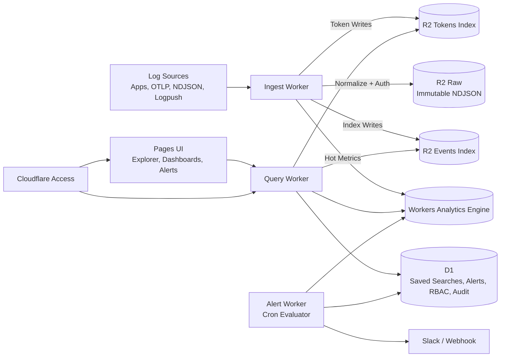

# EdgeData Pitch Deck (Detailed 7-Slide Version)

Use this file as speaker-backed slide content for a Cloudflare PM conversation.

---

## Slide 1 - EdgeData: Cloudflare-Native Operations Control Plane

### On-slide content
- Built for SMB/mid-market teams already running on Cloudflare
- Converts Cloudflare primitives into an incident-response workflow product
- Core loop: alert -> context -> investigation -> runbook

### Speaker notes
EdgeData is not another generic log viewer. It is an operations control layer that sits on top of Cloudflare services to reduce incident triage time for small and mid-sized teams. It packages primitives into an opinionated on-call workflow: alert, immediate context, guided investigation, and runbook execution.

---

## Slide 2 - Problem and Opportunity

### On-slide content
- Cloudflare-first teams still stitch together incident workflows manually
- SMB/mid teams lack dedicated observability specialists; tool complexity slows response
- Result: high MTTR, fragmented context, inconsistent runbook execution
- Opportunity: productize Cloudflare-native operations for faster, repeatable triage

### Speaker notes
Most teams in this segment already have telemetry, but they do not have an integrated operational plane. During incidents, engineers jump between dashboards, raw logs, alert messages, and docs. EdgeData addresses this as a product layer purpose-built for generalist on-call teams.

---

## Slide 3 - Product Aim and Scope

### On-slide content
- Primary objective: reduce mean-time-to-triage and mean-time-to-resolution
- Self-hosted, single-tenant deployment inside each customer Cloudflare account
- Scope today: ingestion, deep search, dashboards, alerts, saved investigations, RBAC/audit
- SSO-first security model through Cloudflare Access with API-enforced authorization

### Speaker notes
The scope is intentionally operational, not broad analytics. The product prioritizes fast path-to-answer during incidents, with explainable query behavior and secure controls. This fits Cloudflare customers who want control and low operational lift.

---

## Slide 4 - Differentiation vs Cloudflare Native Offerings

### On-slide content
- EdgeData complements Cloudflare analytics; it does not replace platform primitives
- Differentiates on workflow state: alert lifecycle, saved context, deep links, runbook metadata
- Unifies app, edge, auth, and security signals into one operations experience
- Backend can evolve without breaking workflow contracts (planner + API abstraction)

### Speaker notes
This is additive to Cloudflare. Cloudflare provides infrastructure and core observability capabilities. EdgeData packages those into an operator-first product for customers who need rapid outcomes with less assembly effort.

---

## Slide 5 - Technical Architecture (Cloudflare-Native)

### On-slide content
- Hot path for fast aggregates/alerts: Workers Analytics Engine (WAE)
- Deep-search truth path: R2-backed events/tokens indexes plus raw immutable archive
- Control/state path: D1 for workflow, RBAC, and audit

### Mermaid diagram

### Speaker notes
Ingest worker authenticates and normalizes logs, then writes to three destinations: raw R2 for source-of-truth, indexed partitions for deep search, and WAE for aggregate analytics. Query worker enforces authz and plans search strategy with guardrails. Alert worker evaluates rules and manages dedupe/cooldowns. Pages UI and APIs are protected by Cloudflare Access with SSO-first posture.

---

## Slide 6 - Roadmap and Future Directions

### On-slide content
- Phase C SIEM-lite: rule packs, enrichment, lightweight correlation, case objects
- Detection engineering UX: templates, tuning feedback loops, explainable detections
- Optional managed acceleration path for scale/compliance without changing API contracts
- Enterprise hardening: service principals, session revocation, richer identity lifecycle controls

### Speaker notes
The roadmap deepens security and operations capabilities while preserving a Cloudflare-first deployment model and low-ops footprint. Storage backends remain an implementation detail; product identity stays in workflow differentiation.

---

## Slide 7 - Partnership Ask for Cloudflare PM

### On-slide content
- Align positioning: EdgeData as operations control layer on Cloudflare
- Co-define starter solution templates for faster time-to-first-value
- Prioritize integration touchpoints across Access, Workers, WAE, R2, D1, and Pages
- Explore co-sell motion for Cloudflare-first SMB/mid-market segment

### Speaker notes
The partnership objective is straightforward: drive customer outcomes and platform pull-through. EdgeData helps Cloudflare customers operationalize faster by packaging primitives into a product experience that is easy for small teams to adopt.
